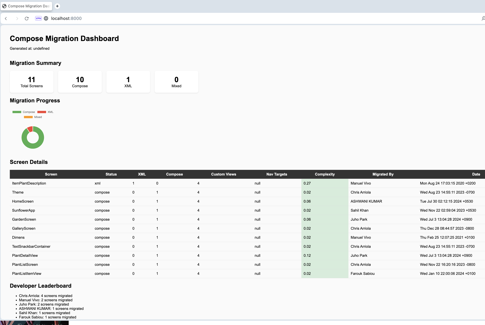

# Jetpack Compose Migration Dashboard for Android apps

I'm using a fork of the "Android Sunflower with Compose" from Google to have usable data for my migration tool.

Instead of writing a demo app to demonstrate my tool, I'm using an example repo which contains a
mix of XML and Compose.

My tool is written in Kotlin, which html/js/css code to display the data.

All the code for the tool is in the `tools/migration-scanner` folder.

The webpage code is directly at the root:
- `index.html`
- `dashboard.js`
- `styles.css`

## Screenshot

## Features

Google's Sunflower sample app showcases how to migrate an existing View-based app (Material 2) to Compose (Material 3).

The goal of _my tool_ is to **automatically generate a HTML page showing data about code migration
from XML Views to Compose**.

The tool will scan the repo's source code to look at:
- count of (remaining) XML View-based screens (using layout XML files)
- count of Compose screens
- total of total screens
- complexity calculation to evaluate complexity of the migration (nothing scientific)
- git history for date and name of committer

In this version of my tool, it analyzes the repo it is sitting in.
A future improvement would be to package it as a Gradle plugin so that it can run in any repo.

The tool works over 3 steps
1. The scanned info is used by the "scanner" to generate a Json file.
2. Then an "aggregator" task uses this Json data to count totals and generate a second Json file.
3. This final Json is then used by static HTML / js  code for display.

## Running the tool
I intend for my tool to be run on CI/CD, with the static HTML used for a Gitlab/Github hosted page.
I'm not fully developing that part here.
As such, this tool can be run as 2 successive jobs.

### Run the scanner
`./gradlew :tools:migration-scanner:run`

If all goes well, the Gradle task will print out:
"Migration scan complete.
Results written to [...]/sunflowerMigrationExample/tools/migration-scanner/../../build/scan-results/screens.json"

This is the first Json file generated, with the raw data.

### Run the aggregator
The aggregator will run on whatever `screens.json` file it finds in the work folder.
`./gradlew :tools:migration-scanner:runAggregation`

If all goes well, the Gradle task will print out:
"Migration aggregation complete. 
Results written to [...]/sunflowerMigrationExample/tools/migration-scanner/../../build/scan-results/screens_aggregated.json"

### Serve the page
If not running on a CI/CD, which should handle serving the HTML page, you can launch a web server locally.

`./gradlew serveDashboard`

The server serves to the URL: `http://localhost:8000/`

The server will run until you type Ctrl-C to stop it.

## Requirements (from the original Google demo Sunflower app)

### Unsplash API key
Normally, you would need this API key to fully use the Sunflower app.
The app is still usable without an API key, though you won't be able to navigate to the gallery screen.

Additional resources
--------------------
Check out these Wiki pages to learn more about Android Sunflower:

- [Notable Community Contributions](https://github.com/android/sunflower/wiki/Notable-Community-Contributions)

- [Publications](https://github.com/android/sunflower/wiki/Sunflower-Publications)

Third Party Content
-------------------
Select text used for describing the plants (in `plants.json`) are used from Wikipedia via CC BY-SA 3.0 US (license in `ASSETS_LICENSE`).

"[seed](https://thenounproject.com/search/?q=seed&i=1585971)" by [Aisyah](https://thenounproject.com/aisyahalmasyira/) is licensed under [CC BY 3.0](https://creativecommons.org/licenses/by/3.0/us/legalcode)
